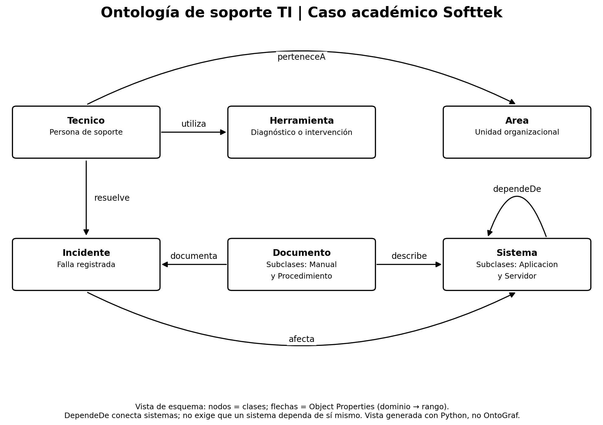
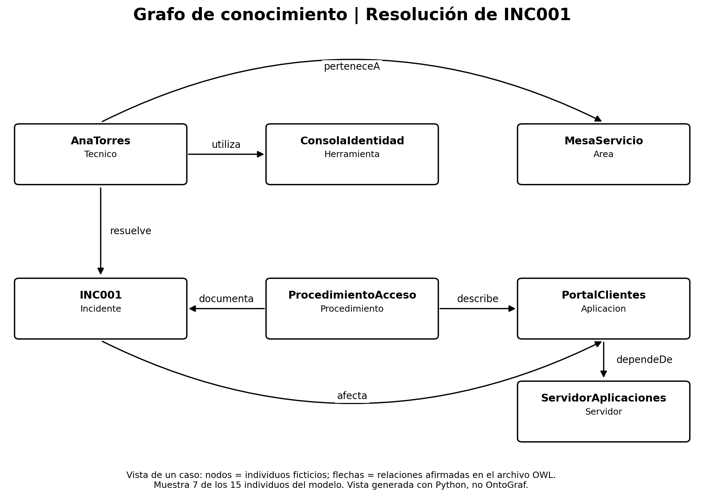

# Ontología y grafo de conocimiento de soporte TI

**Autor:** Isaac Esquivel Ruiz  
**Curso:** Sistemas y tecnologías de administración del conocimiento  
**Dominio:** Soporte técnico de TI  
**Caso de referencia:** Softtek

Esta actividad es independiente del análisis del ciclo de vida del conocimiento. Mantiene la misma empresa como referencia, pero ahora representa conceptos, relaciones y casos mediante una ontología. Todos los técnicos, sistemas, documentos e incidentes incluidos son ficticios. No se presentan como información interna de Softtek.

## Idea principal

La idea es conectar cada incidente con el sistema afectado, el técnico que lo resolvió y el documento que puede servir para otro caso. Así, una solución deja de estar aislada en un ticket y se puede recuperar junto con su contexto. El modelo sirve como base para sistemas de IA que consulten información relacionada y expliquen de dónde sale una recomendación.

## Archivos

| Archivo | Contenido |
|---|---|
| `softtek_soporte_ti.owl` | Ontología OWL en RDF/XML, lista para abrir y editar en Protégé. |
| `grafo_modelo.png` | Esquema de clases y las siete relaciones del modelo, generado con Python. |
| `grafo_caso.png` | Grafo de un caso ficticio, generado desde relaciones verificadas en el OWL. |
| `GUIA_PROTEGE.md` | Pasos para revisar el modelo y exportar la evidencia exigida desde OntoGraf. |
| `VALIDACION.txt` | Resultados reales del razonador y de la consulta SPARQL. |
| `validar_y_visualizar.py` | Validación, consulta y reproducción de las dos imágenes. |
| `requirements.txt` | Dependencias de Python utilizadas. |

## 1. Clases y jerarquías

| Clase principal | Qué representa | Ejemplo ficticio |
|---|---|---|
| Sistema | Recurso tecnológico atendido por soporte. | PortalClientes |
| Incidente | Falla o degradación registrada. | INC001 |
| Tecnico | Persona que atiende incidentes. | AnaTorres |
| Herramienta | Recurso utilizado para diagnóstico o intervención. | ConsolaIdentidad |
| Documento | Conocimiento explícito reutilizable. | ProcedimientoAcceso |
| Area | Unidad organizacional del técnico. | MesaServicio |

Se incluyen **6 clases principales y 4 subclases**, para un total de 10 clases:

- `Aplicacion` y `Servidor` son subclases de `Sistema`.
- `Manual` y `Procedimiento` son subclases de `Documento`.

Estas jerarquías permiten reconocer que una aplicación es un sistema y que un procedimiento es un documento. Las seis clases principales son disjuntas: un incidente no puede ser al mismo tiempo un técnico. Las subclases hermanas no se declaran disjuntas; un documento podría combinar funciones de manual y procedimiento.

## 2. Object Properties

| Propiedad | Dominio → rango | Significado |
|---|---|---|
| resuelve | Tecnico → Incidente | Registra una resolución realizada. |
| utiliza | Tecnico → Herramienta | Relaciona al técnico con una herramienta. |
| perteneceA | Tecnico → Area | Indica su área organizacional. |
| documenta | Documento → Incidente | Vincula un caso con su documentación. |
| afecta | Incidente → Sistema | Identifica el sistema afectado. |
| describe | Documento → Sistema | Identifica el sistema al que se refiere el contenido. |
| dependeDe | Sistema → Sistema | Representa una dependencia directa. |

`resuelve` no significa “está asignado a”. Por eso INC003, que sigue abierto, no tiene un técnico relacionado mediante esa propiedad. `dependeDe` no se declara transitiva: solo representa dependencias directas conocidas. El bucle de esa propiedad en el esquema indica que conecta dos elementos de la misma clase; no obliga a un sistema a depender de sí mismo.

## 3. Data Properties

| Propiedad | Dominio | Tipo |
|---|---|---|
| codigoIncidente | Incidente | xsd:string |
| nivelPrioridad | Incidente | xsd:integer |
| fechaApertura | Incidente | xsd:dateTime |
| estado | Incidente | xsd:string |
| nombreTecnico | Tecnico | xsd:string |
| especialidad | Tecnico | xsd:string |
| versionSistema | Sistema | xsd:string |
| versionDocumento | Documento | xsd:string |
| nombreArea | Area | xsd:string |
| tipoHerramienta | Herramienta | xsd:string |

Son propiedades funcionales: cada individuo puede tener como máximo un valor distinto de cada propiedad en esta versión del modelo. No se modela un historial de versiones. La prioridad usa la convención 1 = crítica, 2 = alta, 3 = media y 4 = baja. El script comprueba ese intervalo; el rango OWL solo exige un entero.

## 4. Representación y consistencia

Todos los conceptos tienen una IRI estable, etiqueta y definición. El espacio de nombres `https://example.org/softtek-academico/soporte-ti#` identifica el caso académico; no es un dominio oficial de la empresa ni necesita abrirse en internet.

Los dominios y rangos permiten inferir tipos. No funcionan como un formulario que rechaza automáticamente cada dato incompleto. OWL usa un supuesto de mundo abierto: no encontrar una relación no demuestra que sea imposible. Por eso se combinan el razonamiento lógico con comprobaciones específicas de los datos del ejemplo.

El razonador HermiT comprobó la consistencia del modelo y que no hay clases insatisfacibles. También se verificó que `PortalClientes` se reconoce como `Sistema`, y `ProcedimientoAcceso` como `Documento`, a partir de sus subclases.

**Interpretación del modelo**  
Organizar el dominio de esta manera me permite separar los conceptos de los casos concretos.  
Un incidente representa el tipo de información y INC001 representa un caso específico.  
Las relaciones indican cómo se conecta ese caso con personas, sistemas y documentos.  
Las jerarquías evitan repetir características que ya corresponden a una clase más general.  
La revisión lógica ayuda a detectar contradicciones dentro de lo que sí está declarado.  
Eso no significa que todos los datos estén completos o sean correctos en la operación real.

## 5. Grafo del modelo



**Interpretación del esquema**  
En este esquema puedo ver las seis clases principales y las siete relaciones del dominio.  
Cada flecha tiene un nombre para que se entienda qué conecta y en qué dirección.  
Los documentos relacionan la experiencia de un incidente con el sistema al que se refiere.  
Los técnicos también quedan conectados con sus herramientas y sus áreas de trabajo.  
Las subclases aparecen dentro de Sistema y Documento para mantener legible la imagen.  
Esta vista explica la estructura general, mientras que el siguiente grafo muestra un caso.

## 6. Casos y reutilización

El OWL contiene **15 individuos**. INC001 es un problema de acceso al portal ya resuelto por Ana Torres; INC002 corresponde a respaldos y fue resuelto por Luis García. INC003 es un nuevo caso abierto que afecta al mismo portal que INC001.



La consulta SPARQL del script encuentra documentos de casos resueltos que afectaron al mismo sistema que un caso abierto. El resultado comprobado fue:

| Caso abierto | Sistema | Caso anterior | Documento candidato | Técnico del caso anterior |
|---|---|---|---|---|
| INC003 | PortalClientes | INC001 | ProcedimientoAcceso | AnaTorres |

**Interpretación del resultado**  
La consulta encontró un procedimiento relacionado con el sistema que presenta el nuevo incidente.  
También recuperó el caso anterior y el técnico que participó en su resolución.  
Eso me permite revisar una solución con contexto, en lugar de buscar un archivo aislado.  
Compartir el mismo sistema no garantiza que ambos incidentes tengan la misma causa.  
Por eso el procedimiento es un candidato que el técnico debe revisar antes de aplicarlo.  
El resultado demuestra recuperación por relaciones, sin afirmar que exista una solución automática.

## 7. Posible apoyo de IA

Un asistente podría identificar el sistema mencionado en un nuevo ticket y consultar el grafo para recuperar procedimientos, casos anteriores y especialistas. Después podría resumir los resultados conservando las conexiones que justifican la respuesta. Las relaciones también permiten analizar qué aplicaciones dependen de un servidor para revisar un posible impacto. Estas son aplicaciones propuestas; no se implementó un modelo generativo ni una clasificación automática en esta actividad.

## 8. Ejecución opcional de la comprobación

Se utilizó Python 3.11 o superior y una instalación de Java disponible en el PATH. La versión exacta ejecutada queda en `VALIDACION.txt`. En la carpeta del repo:

```bash
python -m pip install -r requirements.txt
python validar_y_visualizar.py
```

El script carga el OWL, verifica cantidades y datos, ejecuta HermiT, consulta casos y reproduce las imágenes. Se detiene si alguna comprobación falla. Para abrir la ontología en Protégé no necesitas ejecutar Python.

## 9. Estado de los requisitos de la actividad

| Requisito | Estado |
|---|---|
| Dominio seleccionado | Soporte técnico de TI. |
| Mínimo cinco clases y cinco relaciones | 6 clases principales, 4 subclases y 7 Object Properties. |
| Data Properties y jerarquías | 10 propiedades y 4 relaciones de subclase. |
| Coherencia lógica | Comprobada con HermiT fuera de Protégé. |
| Archivo OWL | Generado en RDF/XML y validado. |
| Trabajo y revisión en Protégé | Pendiente de realizar en el equipo del estudiante. |
| PNG exportado desde OntoGraf | Pendiente; los PNG actuales son visualizaciones auxiliares de Python. |

Para completar el requisito de herramienta, seguir `GUIA_PROTEGE.md`, guardar el OWL desde Protégé y agregar `grafo_ontograf.png` al repo. No se debe presentar una imagen de Python como si hubiera sido exportada por OntoGraf.
